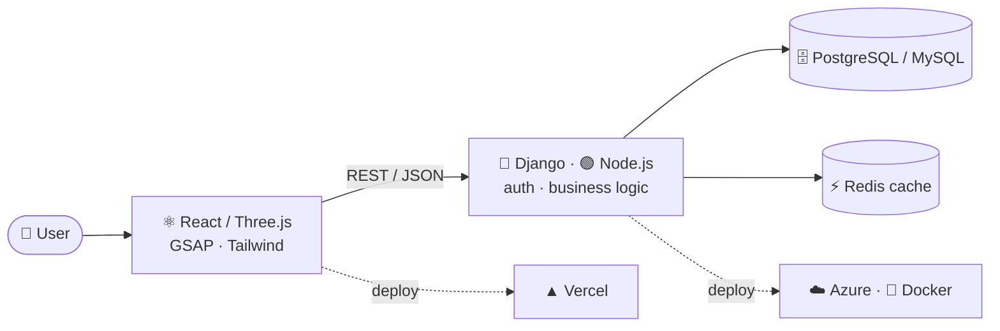

```console
                                 __
   _________ ___  ______  ____ _/ /__
  / ___/ __ `/ / / / __ \/ __ `/ //_/
 / /  / /_/ / /_/ / / / / /_/ / ,<
/_/   \__,_/\__,_/_/ /_/\__,_/_/|_|

raunak@i-Rony-op:~$ whoami && cat /etc/motd
raunak
full stack dev. pixels to databases. 60fps or it didn't ship.
raunak@i-Rony-op:~$ _
```
```console
raunak@github:~$ ss -tulpn | grep raunak
```

| `PID` | `SERVICE` | `ENDPOINT` | `STATE` |
|:-:|:--|:--|:-:|
| `001` | `linkedin` | [`/in/raunak-sharma-5393a9248  ↗`](https://www.linkedin.com/in/raunak-sharma-5393a9248/) | `LISTEN` |
| `002` | `x` | [`@RONY38434557  ↗`](https://x.com/RONY38434557) | `LISTEN` |
| `003` | `instagram` | [`@raunakksharmaa  ↗`](https://www.instagram.com/raunakksharmaa/) | `LISTEN` |
| `004` | `smtp` | [`raunaksharma6205@gmail.com  ↗`](mailto:raunaksharma6205@gmail.com) | `LISTEN` |
| `005` | `git` | [`github.com/i-Rony-op  ↗`](https://github.com/i-Rony-op) | `LISTEN` |


<br/>

```console
raunak@github:~$ neofetch
  ┌──────────────────┐   raunak@i-Rony-op
  │ ●  ●  ●          │   ─────────────────────────────────────────
  ├──────────────────┤   OS        : Full Stack Developer
  │ $ whoami         │   Host      : Maritime Support Solutions
  │ > raunak         │   Location  : Pune, India
  │                  │   Kernel    : JavaScript / TypeScript / Python
  │ $ git commit     │   Shell     : zsh + vim motions
  │ > ship it        │   Frontend  : React · Three.js · GSAP · Tailwind
  │                  │   Backend   : Django · Node.js · Express · REST
  │ $ npm run dev    │   Data      : PostgreSQL · MySQL · MongoDB
  │ > 60fps ▌        │   Cloud     : Azure · Vercel · Docker · CI/CD
  │                  │   Uptime    : shipped a platform for 430+ users
  └──────────────────┘   Packages  : too many (npm i, regret later)
      ╚═══════════╝    
                         ███ ███ ███ ███ ███ ███ ███ ███
```

### `~/raunak $ cat developer.ts`

```ts
interface Engineer { name: string; role: string; ships: string[]; }

export const raunak: Engineer & Record<string, unknown> = {
  name:  "raunak",
  role:  "Full Stack Developer",
  ships: [
    "immersive 3D & motion-driven frontends",       // Three.js · R3F · GSAP
    "production web apps with real users",          // 430+ and counting
    "clean REST APIs and well-modelled databases",  // Django · Node.js · SQL
  ],
  philosophy: [
    "Performance is a feature — 60fps or it didn't ship.",
    "Design and engineering are the same job.",
    "Read the error message. Then read it again.",
  ],
  currentlyLearning: ["Next.js App Router", "WebGL shaders (GLSL)", "system design"],
  pairsWith: ["Claude", "ChatGPT"],   // rubber ducks with opinions
  coffee: Infinity,
};
```

### `~/raunak $ tree ./stack -L 1`

<table>
<tr>
<td width="140"><b> Frontend</b></td>
<td></td>
</tr>
<tr>
<td><b> 3D & Motion</b></td>
<td>


</td>
</tr>
<tr>
<td><b> Backend</b></td>
<td></td>
</tr>
<tr>
<td><b> Data</b></td>
<td></td>
</tr>
<tr>
<td><b> DevOps</b></td>
<td></td>
</tr>
<tr>
<td><b> Tools</b></td>
<td></td>
</tr>
</table>

### `~/raunak $ cat how-i-build.md`



### `~/raunak $ ls -la ./projects`

| | Project | What it does | Stack | Live |
|:-:|---|---|---|:-:|
|  | **Symbi Time Table** | Timetable management platform for an institute: Django backend, animated HTML/CSS/JS frontend, deployed on Azure | Django · JS · GSAP · Azure | — |
|  | **Re-Designn** | Interactive React UI with timeline animation and buttery smooth scroll | React · Framer Motion · GSAP · Lenis | [▶](https://re-design-rony.vercel.app/) |
|  | **Cyberpunk** | 3D landing page with GLTF models, HDR lighting and post-processing | Three.js · GSAP | [▶](https://cyberpunk-three-js.vercel.app/) |
|  | **The Planets** | Orbiting textured planets with HDR lighting and orbit controls | Three.js · GSAP | [▶](https://the-planets-rony.vercel.app/) |
|  | **Obys Agency** | Agency site with Locomotive Scroll and fluid GSAP timelines | HTML · CSS · JS | [▶](https://i-rony-op.github.io/Obys_Agency_Clone/) |
|  | **Rayy Bannnn** | Ray-Ban landing page redesign with smooth navigation | GSAP · JS | [▶](https://i-rony-op.github.io/SheryJS_Modern_Site/) |

### `~/raunak $ git log --stat --all | analyze`

<div align="center">


</div>

### `~/raunak $ ./snake --eat contributions`

<picture>
  <source media="(prefers-color-scheme: dark)" srcset="https://raw.githubusercontent.com/i-Rony-op/i-Rony-op/output/github-snake-dark.svg" />
  <source media="(prefers-color-scheme: light)" srcset="https://raw.githubusercontent.com/i-Rony-op/i-Rony-op/output/github-snake.svg" />
  
</picture>

<div align="center">

```console
raunak@github:~$ ./hire-me.sh
[ok] full stack roles · creative dev · freelance collabs
[ok] response time: < 24h  →  raunaksharma6205@gmail.com
```

</div>
